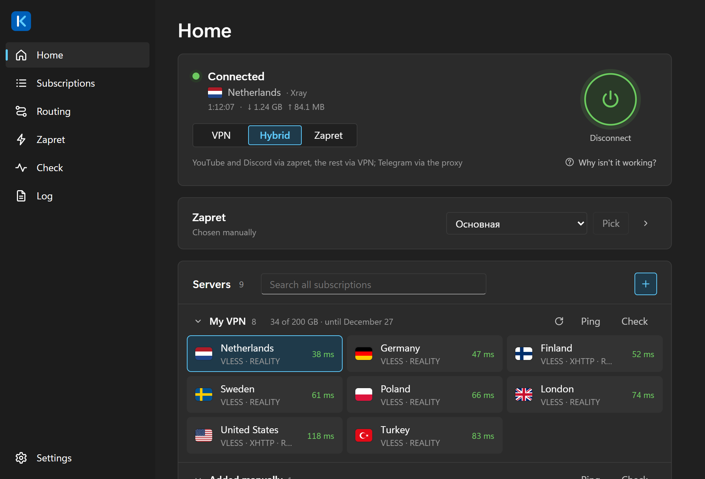
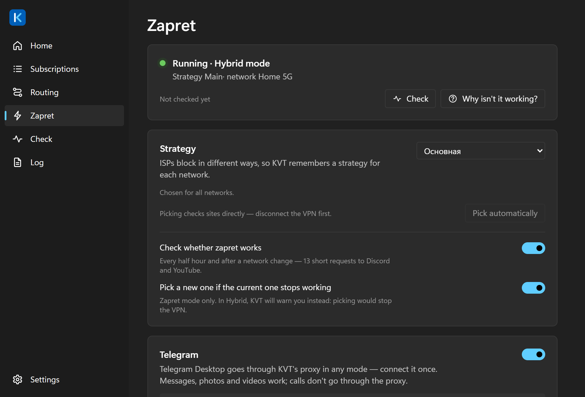
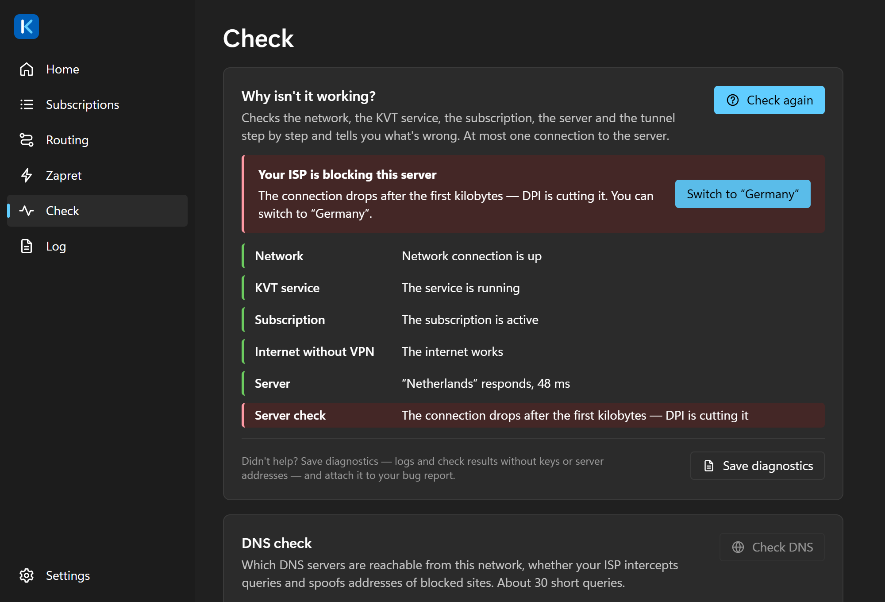
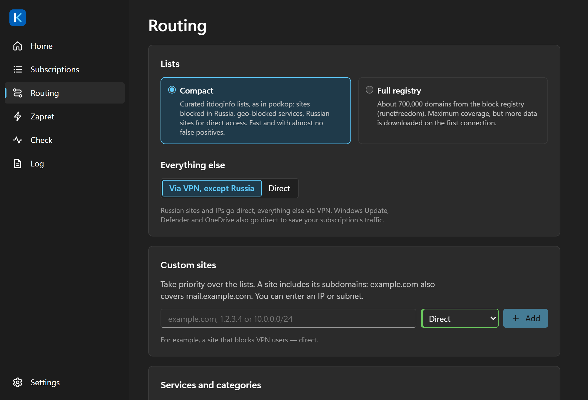

# KVT

**VPN, zapret and Telegram in one window.** 
YouTube and Discord work even without a VPN subscription.

[Русский](README.md) · **English**

### [⬇ Download for Windows](https://github.com/kostiashkaaa/KVT-client/releases/latest)

---

KVT is built for users in Russia: sites that work normally go direct, blocked ones go
through the VPN, and YouTube and Discord can bypass throttling without any VPN server
at all. The interface is in English and Russian; by default it follows the Windows
language.

## Why KVT

- **One app instead of three.** People usually run a VPN client, a zapret batch file
  and a separate proxy for Telegram, and turn zapret off so it doesn't get in the VPN's
  way. In KVT they work together: in Hybrid mode YouTube and Discord go through zapret,
  other blocked sites through the VPN, and Telegram Desktop through the proxy.
- **No VPN? It still works.** Zapret mode gets around YouTube and Discord throttling and
  opens Telegram Desktop with no server or subscription. On first launch choose "I have
  no VPN — just zapret".
- **Tells you what broke.** "Why isn't it working?" checks the network, subscription and
  server step by step and answers in plain words, for example "your ISP is blocking this
  server", with a button to switch to another one.
- **Nothing leaks outside the tunnel.** DNS goes only through the VPN, the kill switch
  blocks the internet if the VPN drops, and the window runs without administrator
  rights.

| | KVT | VPN client v2rayN, Hiddify, Happ | zapret batch file |
|---|:-:|:-:|:-:|
| VPN from a subscription | ✅ | ✅ | — |
| YouTube and Discord without a VPN | ✅ | — | ✅ |
| VPN and zapret at the same time | ✅ | — | — |
| zapret strategy for your network | picked automatically | — | by hand |
| "Why isn't it working?" with an answer | ✅ | — | — |

<table>
  <tr>
    <td></td>
    <td></td>
    <td></td>
  </tr>
  <tr>
    <td align="center">Zapret: a strategy for each network</td>
    <td align="center">"Why isn't it working?"</td>
    <td align="center">Routing by lists</td>
  </tr>
</table>

## Features

- **Subscriptions and keys in one list.** Paste a subscription URL or `vless://`,
  `vmess://`, `trojan://`, `ss://`, `hy2://`, `tuic://`, `anytls://` keys. Servers show up grouped, with country flags,
  search and a ping check. Subscriptions refresh on their own.
- **Split routing out of the box.** Russian sites go direct, blocked ones go through
  the VPN, based on the [itdoginfo](https://github.com/itdoginfo/allow-domains) and
  [runetfreedom](https://github.com/runetfreedom/russia-v2ray-rules-dat) lists.
- **YouTube and Discord without a VPN server.** Built-in
  [zapret](https://github.com/Flowseal/zapret-discord-youtube) gets around DPI
  throttling, either next to the VPN (Hybrid mode) or instead of it (Zapret mode).
  KVT picks a working strategy for your network.
- **Telegram without a VPN server.** A proxy for Telegram Desktop
  ([tg-ws-proxy](https://github.com/valnesfjord/tg-ws-proxy-rs)) runs alongside zapret:
  press "Connect Telegram" on the Zapret tab once, and messages, photos and videos go
  through without the VPN.
- **Kill switch.** If the VPN drops, the internet stays closed until you say otherwise,
  so nothing leaks outside the tunnel.
- **Automatic server switching.** Once a minute KVT checks that traffic is flowing and
  moves to the next working server in the subscription if it isn't.
- **"Why isn't it working?"** A step-by-step check of the network, DNS, subscription and
  server that ends in a plain answer and a button to fix it.
- **Runs from the tray.** Change the server, mode or kill switch from the tray menu.
  Connection time and traffic are shown on the home screen and in the tray.
- **Moving from another client.** Subscriptions and keys from v2rayN, Hiddify and
  NekoRay/Throne carry over in a couple of clicks.

Protocols: VLESS (Reality, XTLS Vision; TCP, WebSocket, gRPC, HTTPUpgrade, XHTTP),
VMess, Trojan, Shadowsocks, Hysteria2, TUIC, AnyTLS. Cores: [Xray](https://github.com/XTLS/Xray-core) and
[sing-box](https://github.com/SagerNet/sing-box); KVT chooses the right one per server.

## Install

1. Download `KVT-x.y.z-setup.exe` from
   [Releases](https://github.com/kostiashkaaa/KVT-client/releases/latest).
2. Run it and approve the administrator prompt. You only see it once: KVT installs into
   `C:\Program Files\KVT` together with its background service.
3. On first launch KVT walks you through three steps: add a subscription, pick a mode,
   connect.

Requires 64-bit Windows 10 (22H2) or 11. For a machine without internet access, use
`KVT-x.y.z-offline-setup.exe`, which bundles WebView2.

<b>Windows says "Windows protected your PC"</b>

KVT doesn't have a paid code signing certificate yet, so SmartScreen warns about an
unknown publisher. Click "More info" and then "Run anyway".

To make sure the file wasn't tampered with:

- compare the SHA-256 from the release notes with `Get-FileHash KVT-x.y.z-setup.exe`
  in PowerShell;
- or check the build attestation. The installers are built by GitHub Actions from this
  repository's source, which you can verify with
  `gh attestation verify KVT-x.y.z-setup.exe --repo kostiashkaaa/KVT-client`.

<b>The installer won't start: "Smart App Control blocked…"</b>

Smart App Control is a Windows 11 feature. Unlike SmartScreen, it has no "Run anyway"
button: while it's on, unsigned programs don't start at all, and KVT isn't signed yet.

To turn Smart App Control off, go to Windows Security → App & browser control → Smart App
Control settings → Off. SmartScreen and your antivirus keep working. Note that on many
Windows 11 builds the only way to turn Smart App Control back on is to reinstall
Windows.

<b>My antivirus flags WinDivert or winws</b>

Those are zapret components. The WinDivert driver intercepts packets to get around
YouTube and Discord throttling, which is how every DPI bypass works, and some antivirus
products label it "potentially unwanted". KVT takes these files from the official
Flowseal release and checks their SHA-256 before every start.

If you use Hybrid or Zapret mode, add `C:\Program Files\KVT\zapret` to your antivirus
exclusions. In VPN mode zapret doesn't run.

## Updating and uninstalling

When a new version comes out, KVT tells you and links to
[Releases](https://github.com/kostiashkaaa/KVT-client/releases). You download and
install it yourself: KVT never downloads or runs anything on its own. You can turn these
messages off in Settings → About.

- **`KVT-x.y.z-update.exe`** updates an installed KVT and weighs a few megabytes. The
  VPN disconnects for a few seconds; settings and subscriptions stay.
- **`KVT-x.y.z-setup.exe`** run over an existing install also works as an update.

To uninstall, go to Settings → Apps → KVT. The service, the WinDivert driver and
`C:\ProgramData\KVT` are removed; tick "Delete app data" to remove your settings and
subscriptions too. Your internet connection keeps working afterwards.

## Modes

| Mode | Through the VPN | Through zapret | When to use |
|---|---|---|---|
| **VPN** | Blocked sites | none | Default |
| **Hybrid** | Blocked sites except YouTube and Discord | YouTube and Discord; Telegram via the proxy | Less load on the server, faster video |
| **Zapret** | none | YouTube and Discord; Telegram via the proxy | You have no VPN server |

Russian sites go direct in every mode. Whether everything else goes through the VPN or
only blocked sites do is set in the Routing section.

## FAQ

**It connected, but sites don't open.** Press "Why isn't it working?" on the home
screen. KVT checks the network, DNS and server and tells you what to do. Another server
or Hybrid mode often helps.

**Where do I get a subscription?** From your VPN provider: an `https://…` link or
`vless://`, `vmess://`, `trojan://`, `ss://`, `hy2://`, `tuic://`, `anytls://` keys.
KVT doesn't sell or advertise keys.

**Coming from v2rayN, Hiddify or NekoRay?** Subscriptions → "Import from another
client". For Happ, copy the subscription URL by hand: Happ stores it encrypted.

**I closed the window. Is the VPN off?** No, KVT keeps running in the tray. To quit
completely, choose Exit in the tray menu.

**What does KVT send over the network?** Only what it needs: subscriptions, server
checks, routing lists, and every 12 hours a question to GitHub about the latest KVT
version. Every request shows up in the Log section. There's no telemetry.

**Found a bug?** Open an [issue](https://github.com/kostiashkaaa/KVT-client/issues) and
attach a diagnostics archive from Diagnostics → "Save diagnostics". Keys and server
addresses are stripped, and KVT shows you every file before saving.

## Security and privacy

- **Your keys stay on your machine.** Subscription URLs and keys are encrypted with
  Windows DPAPI, so only your user account can read them. They never reach the UI,
  logs or diagnostics.
- **Separate privileges.** The window runs as a normal user. Anything that needs admin
  rights (TUN, routes, the kill switch) is done by the service, and the service only
  accepts commands from the `kvt.exe` in its own install folder.
- **No open ports.** In TUN mode KVT runs no local proxy that another program could use
  to find out your server's address.
- **Gentle on the network.** Checks and updates are rate-limited, with no request bursts
  that Russian DPI systems react to.
- **No telemetry, no ads.**

If you find a vulnerability, please report it privately as described in
[SECURITY.md](SECURITY.md).

## Contributing

KVT is written in Rust (Tauri 2) and Svelte 5. Build and run instructions are in
[CONTRIBUTING.md](CONTRIBUTING.md) (in Russian).

## License

KVT is licensed under the [GNU GPL v3](LICENSE) or later. Third-party components and
their licenses are listed in [THIRD-PARTY-NOTICES.md](THIRD-PARTY-NOTICES.md).
