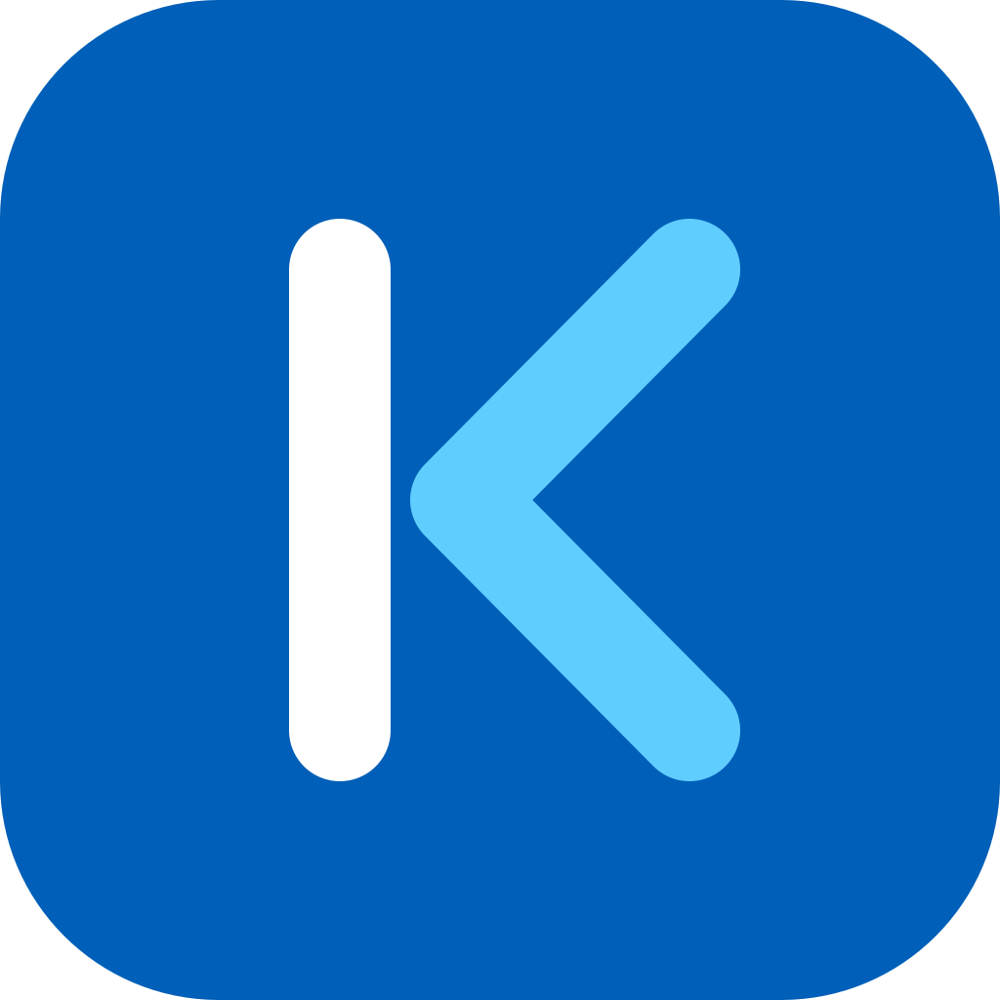

# KVT

**Открытый VPN-клиент для Windows: подписки, обход блокировок и zapret в одном окне.**

**Русский** · [English](README.en.md)

### [⬇ Скачать для Windows](https://github.com/kostiashkaaa/KVT-client/releases/latest)

---

## Что умеет

- **Подписки и ключи в одном списке.** Вставьте ссылку на подписку или ключи
  `vless://`, `trojan://`, `ss://`, `hy2://` — серверы появятся группами, с флагами
  стран, поиском и проверкой пинга. Подписки обновляются сами.
- **Российские сайты — напрямую, заблокированное — через VPN.** Маршрутизация по
  спискам [itdoginfo](https://github.com/itdoginfo/allow-domains) и
  [runetfreedom](https://github.com/runetfreedom/russia-v2ray-rules-dat), без ручной
  настройки.
- **YouTube и Discord без VPN-сервера.** Встроенный
  [zapret](https://github.com/Flowseal/zapret-discord-youtube) обходит замедление: в
  режиме «Гибрид» — рядом с VPN, в режиме «Zapret» — вместо него. Стратегию KVT
  подбирает сам.
- **Kill switch.** Если VPN оборвался, интернет закрыт, пока вы не решите иначе: ни
  один запрос не уйдёт мимо туннеля.
- **Сервер упал — KVT переключится.** Раз в минуту KVT проверяет, идут ли данные, и при
  сбое переходит на следующий рабочий сервер подписки.
- **«Почему не работает?»** Пошаговая проверка сети, DNS, подписки и сервера с понятным
  ответом и кнопкой, что делать.
- **Работает из трея.** Сервер, режим и kill switch меняются из меню у часов, окно
  можно не открывать. Время подключения и трафик видны на главной и в трее.
- **Переезд из других клиентов.** Подписки и ключи из v2rayN, Hiddify и NekoRay/Throne
  переносятся в пару кликов.

Протоколы: VLESS (Reality, XTLS Vision; TCP, WebSocket, gRPC, HTTPUpgrade, XHTTP),
Trojan, Shadowsocks, Hysteria2. Ядра — [Xray](https://github.com/XTLS/Xray-core) и
[sing-box](https://github.com/SagerNet/sing-box), подходящее KVT выбирает сам.

## Установка

1. Скачайте `KVT-x.y.z-setup.exe` на странице
   [Releases](https://github.com/kostiashkaaa/KVT-client/releases/latest).
2. Запустите и подтвердите права администратора — это нужно один раз: KVT ставится в
   `C:\Program Files\KVT` вместе со своей службой.
3. При первом запуске KVT подскажет три шага: добавить подписку, выбрать режим,
   подключиться.

Нужна 64-битная Windows 10 (22H2) или 11. Для компьютера без интернета есть
`KVT-x.y.z-offline-setup.exe` — в нём уже есть WebView2.

<b>Windows пишет «Система Windows защитила ваш компьютер»</b>

У KVT пока нет платного сертификата подписи, поэтому SmartScreen предупреждает о
неизвестном издателе. Нажмите «Подробнее» → «Выполнить в любом случае».

Убедиться, что файл не подменён, можно двумя способами:

- сравнить SHA-256 из описания релиза с выводом `Get-FileHash KVT-x.y.z-setup.exe` в
  PowerShell;
- проверить аттестацию: установщики собирает GitHub Actions из исходников этого
  репозитория, это подтверждает команда
  `gh attestation verify KVT-x.y.z-setup.exe --repo kostiashkaaa/KVT-client`.

<b>Установщик не запускается: «Интеллектуальное управление приложениями заблокировало…»</b>

Это Smart App Control из Windows 11. В отличие от SmartScreen, кнопки «Выполнить в
любом случае» у него нет: пока он включён, программы без подписи не запускаются
вообще, а подписи у KVT пока нет.

Выключить Smart App Control: «Безопасность Windows» → «Управление приложениями и
браузером» → «Параметры интеллектуального управления приложениями» → «Отключено».
SmartScreen и антивирус продолжат работать. Учтите, что на многих сборках Windows 11
включить Smart App Control обратно можно только переустановкой системы.

<b>Антивирус ругается на WinDivert или winws</b>

Это компоненты zapret: драйвер WinDivert перехватывает пакеты, чтобы обойти замедление
YouTube и Discord. Так работает любой обход DPI, и часть антивирусов помечает его как
«потенциально нежелательное ПО». KVT берёт эти файлы из официального релиза Flowseal и
сверяет SHA-256 перед каждым запуском.

Если пользуетесь режимом «Гибрид» или «Zapret», добавьте `C:\Program Files\KVT\zapret`
в исключения антивируса. В режиме «VPN» zapret не запускается.

## Обновление и удаление

Когда выходит новая версия, KVT сообщает об этом и даёт ссылку на страницу
[Releases](https://github.com/kostiashkaaa/KVT-client/releases). Скачиваете и
устанавливаете её вы сами: KVT ничего не загружает и не запускает. Сообщения
выключаются в «Настройки» → «О программе».

- **`KVT-x.y.z-update.exe`** — обновление установленного KVT, несколько мегабайт.
  VPN отключится на несколько секунд, настройки и подписки сохранятся.
- **`KVT-x.y.z-setup.exe`** поверх установленного KVT тоже обновляет его.

Удаление — «Параметры» → «Приложения» → KVT. Служба, драйвер WinDivert и
`C:\ProgramData\KVT` удаляются, галочка «Удалить данные приложения» стирает ещё
настройки и подписки. Интернет после удаления работает как обычно.

## Режимы

| Режим | Через VPN | Через zapret | Когда выбрать |
|---|---|---|---|
| **VPN** | Заблокированное | — | Обычный выбор |
| **Гибрид** | Заблокированное, кроме YouTube и Discord | YouTube и Discord | Меньше нагрузки на сервер, видео быстрее |
| **Zapret** | — | YouTube и Discord | VPN-сервера нет |

Российские сайты во всех режимах открываются напрямую. Пустить через VPN всё, кроме
российского, или только заблокированное — выбирается в разделе «Маршрутизация».

## Частые вопросы

**Подключилось, но сайты не открываются.** Нажмите «Почему не работает?» на главной:
KVT проверит сеть, DNS и сервер и подскажет, что сделать. Часто помогает другой сервер
или режим «Гибрид».

**Где взять подписку?** У вашего VPN-провайдера: это ссылка `https://…` или ключи
`vless://`, `trojan://`, `ss://`, `hy2://`. KVT не продаёт и не рекламирует ключи.

**Переходите с v2rayN, Hiddify или NekoRay?** «Подписки» → «Перенести из другого
клиента». Из Happ скопируйте ссылку подписки вручную: Happ хранит её зашифрованной.

**Закрыл окно — VPN выключился?** Нет, KVT остаётся в трее у часов. Чтобы выйти
совсем, выберите «Выход» в меню трея.

**Что KVT отправляет в сеть?** Только то, что нужно для работы: подписки, проверки
серверов, списки маршрутизации и раз в 12 часов вопрос к GitHub, какая версия KVT
последняя. Каждый запрос виден в разделе «Журнал». Телеметрии нет.

**Нашли ошибку?** Опишите её в [Issues](https://github.com/kostiashkaaa/KVT-client/issues)
и приложите диагностику: «Проверка» → «Сохранить диагностику». Ключи и адреса серверов
в неё не попадают, а окно покажет каждый файл перед сохранением.

## Безопасность и приватность

- **Ключи никуда не уходят.** Ссылки подписок и ключи хранятся зашифрованными (DPAPI
  Windows), прочитать их может только ваша учётная запись. В интерфейс, журналы и
  диагностику они не попадают.
- **Права разделены.** Окно работает с правами пользователя. Всё, что требует прав
  администратора (TUN, маршруты, kill switch), делает служба, а она принимает команды
  только от `kvt.exe` из своей папки установки.
- **Нет открытых портов.** В режиме TUN KVT не поднимает локальных прокси, через которые
  другие программы могли бы узнать адрес сервера.
- **Бережно к сети.** Проверки и обновления идут с лимитами и паузами, без всплесков
  запросов, на которые реагирует ТСПУ.
- **Без телеметрии и рекламы.**

Нашли уязвимость — сообщите приватно, как описано в [SECURITY.md](SECURITY.md).

## Участие в разработке

KVT написан на Rust (Tauri 2) и Svelte 5. Как собрать и запустить его из исходников,
описано в [CONTRIBUTING.md](CONTRIBUTING.md).

## Лицензия

KVT распространяется по лицензии [GNU GPL v3](LICENSE) или более поздней. Сторонние
компоненты и их лицензии перечислены в [THIRD-PARTY-NOTICES.md](THIRD-PARTY-NOTICES.md).
